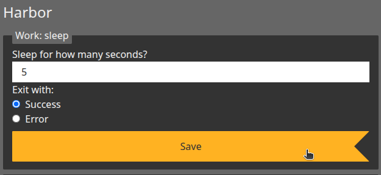
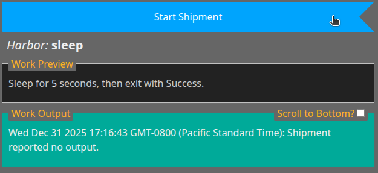

# harbormaster-sleep

A Harbor for sleeping a specified number of seconds.

Active shipments recover from their original `manifest` and `actual` start time.
The core saves both together before calling `work`. Sleep derives its deadline
from that snapshot, so recovery preserves the duration and exit code after lane
edits. Previously saved `sleep_resume` deadlines remain supported.

Requires Harbormaster's durable shipment recovery and `resume()` lifecycle.
`register()` has no recovery side effects; core calls `resume()` after all
harbors initialize. Completion and database errors retry after 30 seconds.
Sleep does not write separate settings or infer missing inputs from lane edits.

Existing active shipments without a saved manifest require the core's offline
Sleep migration before upgrading. Its preview identifies records whose settings
must be reconstructed from current lane configuration.

`npm test` runs lint and enforces 100% line, branch, and function coverage of
`sleep.js` using Node 22's test runner. No additional test dependency is needed.

## Screenshots





## ESLint

```bash
npm run lint
npm run lint:fix
npm test
```
