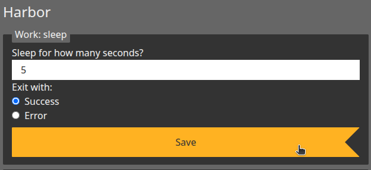
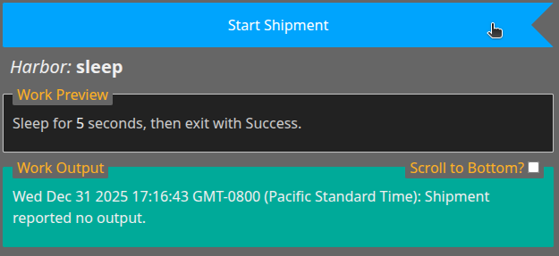

# harbormaster-sleep

A Harbor for sleeping a specified number of seconds.

Active shipments save their deadline and original manifest. After a server
restart, the harbor schedules the remaining time or completes overdue work.
Shipments started before this behavior was added use their recorded `actual`
timestamp and the lane's current settings for recovery.

## Screenshots





## ESLint

```bash
npm run lint
npm run lint:fix
npm test
```
